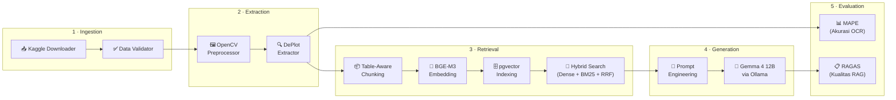

# 📊 Analisis Grafik Finansial — RAG Pipeline

> Sistem cerdas berbasis **Retrieval-Augmented Generation (RAG)** yang mampu mengekstrak data dari gambar grafik finansial, menyimpannya ke vector database, dan menjawab pertanyaan analitis menggunakan LLM lokal.


---

## 📖 Deskripsi Project

Dalam dunia finansial, banyak data penting yang tersaji dalam bentuk **gambar grafik** — seperti laporan tahunan, presentasi investor, atau dokumen PDF. Mengekstrak data dari gambar-gambar ini secara manual sangat memakan waktu dan rentan kesalahan.

Project ini menyediakan **pipeline end-to-end** yang secara otomatis:

1. **Membaca** gambar grafik finansial menggunakan Computer Vision dan model DePlot
2. **Mengekstrak** data numerik dari grafik menjadi tabel terstruktur
3. **Menyimpan** data tersebut ke vector database untuk pencarian semantik
4. **Menjawab** pertanyaan analitis tentang data menggunakan LLM lokal (tanpa kirim data ke cloud)
5. **Mengevaluasi** kualitas ekstraksi dan jawaban secara otomatis

---

## ✨ Fitur Utama

| Fitur | Deskripsi |
|---|---|
| 🔍 **Ekstraksi Grafik Otomatis** | Mengubah gambar grafik/chart menjadi tabel data terstruktur menggunakan Google DePlot |
| 🖼️ **Pra-Pemrosesan Cerdas** | Pembersihan gambar otomatis dengan OpenCV — mendeteksi semua warna garis chart secara universal |
| 🧠 **Hybrid Search (RAG)** | Kombinasi Dense Vector Search + BM25 Sparse Search + Reciprocal Rank Fusion untuk pencarian konteks yang akurat |
| 💬 **Tanya-Jawab Berbasis Data** | LLM lokal (Gemma 4 12B) menjawab pertanyaan HANYA berdasarkan data yang diekstrak — meminimalisir halusinasi |
| 📈 **Analisis Pola & Tren** | Deskripsi naratif otomatis tentang tren, puncak, dan insight dari grafik |
| ✅ **Evaluasi Ganda** | MAPE untuk akurasi OCR + RAGAS Framework untuk kualitas RAG (Faithfulness, Relevancy, Precision, Recall) |
| 🔒 **100% Lokal & Privat** | Semua pemrosesan LLM berjalan di mesin lokal via Ollama — data finansial tidak pernah keluar |

---

## 🏗️ Arsitektur Sistem

### Diagram Pipeline



### Alur Data End-to-End

```
Gambar Grafik (.jpg/.png)
        │
        ▼
┌─────────────────────────┐
│ 1. INGESTION            │  Download dataset dari Kaggle
│    └─ Validasi format   │  Parsing & validasi tabel (cek numerik, persentase)
└─────────┬───────────────┘
          ▼
┌─────────────────────────┐
│ 2. EXTRACTION           │  Pra-pemrosesan gambar (OpenCV HSV filtering)
│    └─ DePlot OCR        │  Gambar grafik → Pandas DataFrame
└─────────┬───────────────┘
          ▼
┌─────────────────────────┐
│ 3. RETRIEVAL            │  Baris tabel → kalimat deskriptif (chunking)
│    └─ Indexing           │  Embedding (BGE-M3) → simpan ke PostgreSQL/pgvector
│    └─ Hybrid Search     │  Dense + BM25 + RRF → konteks terbaik
└─────────┬───────────────┘
          ▼
┌─────────────────────────┐
│ 4. GENERATION           │  Strict prompt + konteks → Gemma 4 12B (Ollama)
│    └─ Jawaban analitis  │  "Berdasarkan data X, nilainya adalah Y..."
└─────────┬───────────────┘
          ▼
┌─────────────────────────┐
│ 5. EVALUATION           │  MAPE: akurasi ekstraksi DePlot
│    └─ RAGAS metrics     │  Faithfulness, Relevancy, Precision, Recall
└─────────────────────────┘
```

---

## 🛠️ Tech Stack

| Kategori | Teknologi | Fungsi |
|---|---|---|
| **Vision / OCR** | [Google DePlot](https://huggingface.co/google/deplot) (Pix2Struct) | Mengekstrak data tabel dari gambar grafik |
| **Image Processing** | [OpenCV](https://opencv.org/) | Pra-pemrosesan gambar (deteksi warna, isolasi chart) |
| **Embedding** | [BAAI/bge-m3](https://huggingface.co/BAAI/bge-m3) (SentenceTransformer) | Mengubah teks menjadi vektor numerik untuk pencarian semantik |
| **Vector Database** | [PostgreSQL](https://www.postgresql.org/) + [pgvector](https://github.com/pgvector/pgvector) | Menyimpan dan mencari vektor embedding |
| **Sparse Search** | [rank-bm25](https://github.com/dorianbrown/rank_bm25) | Pencarian berbasis kecocokan kata kunci (BM25Okapi) |
| **LLM** | [Gemma 4 12B](https://ai.google.dev/gemma) via [Ollama](https://ollama.ai/) | Model bahasa lokal untuk generasi jawaban |
| **RAG Framework** | [LangChain](https://www.langchain.com/) | Orkestrasi komponen RAG |
| **Evaluation** | [RAGAS](https://docs.ragas.io/) | Evaluasi kualitas pipeline RAG |
| **Data Science** | Pandas, NumPy, Matplotlib, scikit-learn | Manipulasi data, perhitungan metrik, visualisasi |
| **Notebook** | Jupyter Notebook | Eksplorasi dan eksperimen data interaktif |
| **Dataset** | [Kaggle](https://www.kaggle.com/datasets/varadsrivastava/financial-chart-ocr) | Sumber dataset grafik finansial |

---

## 📁 Struktur Direktori

```
analisis-grafik/
│
├── 📄 .env.example              # Template konfigurasi environment variables
├── 📄 .gitignore                 # File/folder yang diabaikan Git
├── 📄 requirements.txt           # Daftar semua dependensi Python
├── 📄 README.md                  # Dokumentasi project (file ini)
│
├── 📂 data/                      # Data gambar grafik
│   ├── gambar_uji.jpg            # Gambar uji coba 1
│   ├── gambar_uji2.jpg           # Gambar uji coba 2
│   ├── gambar_uji2.png           # Gambar uji coba 3
│   └── 📂 raw/                   # Dataset mentah dari Kaggle
│       ├── 📂 natural_data/      # Data grafik natural (annotations, images)
│       │   ├── 📂 annotations/   # Anotasi ground truth
│       │   ├── 📂 images/        # Gambar grafik asli
│       │   └── index.json        # Indeks metadata dataset
│       └── 📂 synthetic_data/    # Data grafik sintetis
│           ├── 📂 charts/        # Gambar chart sintetis
│           └── 📂 markdown/      # Data tabel dalam format markdown
│
├── 📂 notebooks/                 # Jupyter Notebooks untuk eksperimen
│   ├── data_exploration.ipynb    # Eksplorasi dan analisis dataset
│   ├── data_validation.ipynb     # Validasi kualitas data
│   └── vision_extraction_test.ipynb  # Pengujian ekstraksi vision DePlot
│
└── 📂 src/                       # Source code utama (modular pipeline)
    ├── __init__.py
    │
    ├── 📂 ingestion/             # Module 1: Data Ingestion
    │   ├── downloader.py         #   → Download dataset dari Kaggle API
    │   └── validator.py          #   → Parsing & validasi tabel finansial
    │
    ├── 📂 extraction/            # Module 2: Chart Data Extraction
    │   ├── __init__.py
    │   ├── cv_preprocessor.py    #   → Pra-pemrosesan gambar (OpenCV)
    │   └── deplot_extractor.py   #   → Ekstraksi data tabel (Google DePlot)
    │
    ├── 📂 retrieval/             # Module 3: Vector Search & Indexing
    │   ├── __init__.py
    │   ├── indexer.py            #   → Chunking, embedding, & insert ke pgvector
    │   └── search.py             #   → Hybrid search (Dense + BM25 + RRF)
    │
    ├── 📂 generation/            # Module 4: LLM-based Analysis & QA
    │   ├── __init__.py
    │   ├── llm_client.py         #   → RAG pipeline end-to-end
    │   ├── prompts.py            #   → Template prompt untuk analisis grafik
    │   └── analyze_vision.py     #   → Pipeline DePlot → LLM (deskripsi naratif)
    │
    └── 📂 evaluation/            # Module 5: Quality Evaluation
        ├── __init__.py
        ├── evaluate_extraction.py #  → Evaluasi akurasi OCR dengan MAPE
        └── ragas_eval.py          #  → Evaluasi kualitas RAG dengan RAGAS
```

---

## 📋 Prasyarat (Prerequisites)

Pastikan software berikut sudah terinstall di sistem Anda:

| Software | Versi Minimum | Keterangan |
|---|---|---|
| **Python** | 3.10+ | Runtime utama |
| **PostgreSQL** | 14+ | Database untuk pgvector |
| **pgvector** | 0.5+ | Ekstensi vektor untuk PostgreSQL |
| **Ollama** | Latest | Runtime LLM lokal |
| **Git** | 2.0+ | Version control |
| **Kaggle CLI** | Latest | Untuk download dataset (opsional) |

### Kebutuhan Hardware

| Komponen | Minimum | Rekomendasi |
|---|---|---|
| **RAM** | 16 GB | 32 GB |
| **VRAM (GPU)** | 8 GB | 12+ GB |
| **Storage** | 20 GB free | 50 GB free |

> **Catatan:** Model Gemma 4 12B membutuhkan setidaknya ~8 GB VRAM. Jika GPU tidak tersedia, Ollama akan menggunakan CPU (lebih lambat).

---

## 🚀 Instalasi & Setup

### 1. Clone Repository

```bash
git clone <repository-url>
cd analisis-grafik
```

### 2. Buat Virtual Environment

```bash
python -m venv venv

# Windows
venv\Scripts\activate

# Linux / macOS
source venv/bin/activate
```

### 3. Install Dependensi

```bash
pip install -r requirements.txt
```

### 4. Konfigurasi Environment Variables

Salin file template dan isi dengan kredensial Anda:

```bash
cp .env.example .env
```

Edit file `.env` dengan konfigurasi berikut:

```env
# Kaggle API (untuk download dataset)
KAGGLE_USERNAME=username_kaggle_anda
KAGGLE_KEY=api_key_kaggle_anda

# PostgreSQL Database
DB_HOST=localhost
DB_PORT=5433
DB_NAME=financial_rag
DB_USER=postgres
DB_PASS=postgres
```

### 5. Setup PostgreSQL + pgvector

```bash
# Buat database
createdb financial_rag

# Install ekstensi pgvector (di dalam psql)
psql -d financial_rag -c "CREATE EXTENSION IF NOT EXISTS vector;"
```

**Atau menggunakan Docker (rekomendasi):**

```bash
docker run -d \
  --name pgvector-db \
  -e POSTGRES_PASSWORD=postgres \
  -e POSTGRES_DB=financial_rag \
  -p 5433:5432 \
  pgvector/pgvector:pg16
```

### 6. Install & Jalankan Ollama

```bash
# Install Ollama (https://ollama.ai)
# Lalu download model Gemma 4 12B:
ollama pull gemma4:12b
```

Pastikan Ollama berjalan di background:

```bash
ollama serve
```

### 7. Studio Frontend (UI)

Studio adalah satu ruang kerja: unggah grafik, lihat ekstraksi, baca insight, lalu tanya jawab.

**Backend API** (dari root project, virtualenv aktif):

```bash
pip install -r requirements.txt
python -m uvicorn src.api.main:app --reload --port 8000
```

**Frontend** (terminal kedua):

```bash
cd frontend
npm install
npm run dev
```

Buka [http://localhost:5173](http://localhost:5173). Vite mem-proxy `/api` ke port 8000. Pastikan Ollama berjalan untuk insight dan tanya jawab; PostgreSQL + pgvector diperlukan agar indexing RAG berhasil. Jika database mati, analisis tabel/insight tetap bisa jalan — panel tanya jawab akan menandai basis vektor belum terhubung.

### 8. Download Dataset (Opsional)

```bash
python src/ingestion/downloader.py
```

> Dataset akan otomatis diunduh dan diekstrak ke folder `data/raw/`.

---

## 💻 Cara Penggunaan

### Pipeline Lengkap (Step by Step)

#### Tahap 1 — Pra-Pemrosesan Gambar (OpenCV)

Bersihkan gambar grafik dari noise, grid, dan background untuk meningkatkan akurasi DePlot:

```bash
python src/extraction/cv_preprocessor.py
```

Hasil: gambar bersih disimpan di `data/processed_all_colors.jpg`

#### Tahap 2 — Ekstraksi Data dari Grafik (DePlot)

Ubah gambar grafik menjadi tabel data terstruktur:

```bash
python src/extraction/deplot_extractor.py
```

Output contoh:
```
[1/3] Membaca gambar dari: data/gambar_uji2.png
[2/3] Hasil ekstraksi mentah (raw teks) dari DePlot
[3/3] Berhasil distrukturkan ke bentuk Tabel Pandas:
   Tahun  Pendapatan (Juta $)  Laba Bersih (%)
   2021          150.5              12.5
   2022          200.0              14.0
```

#### Tahap 3 — Indexing ke Vector Database

Simpan data yang sudah diekstrak ke PostgreSQL/pgvector:

```bash
python src/retrieval/indexer.py
```

Proses yang terjadi:
1. Table-aware chunking (baris → kalimat deskriptif)
2. Embedding dengan model BGE-M3
3. Bulk insert ke tabel `financial_docs`

#### Tahap 4 — Tanya-Jawab RAG (Hybrid Search + LLM)

Ajukan pertanyaan dan dapatkan jawaban berbasis data:

```bash
python src/generation/llm_client.py
```

Contoh interaksi:
```
User: Berapa persen laba bersih pada tahun 2023 berdasarkan simulasi laporan?

[Proses] Menjalankan pencarian konteks (Vector + BM25)...
[Proses] Menghubungi model gemma4:12b via API lokal...

=== JAWABAN LLM ===
Berdasarkan Tren Pendapatan Tahunan (Sumber: Laporan_Q3_Simulasi.png),
laba bersih pada tahun 2023 adalah 18.2%.
===================
```

#### Tahap 5 — Analisis Pola Grafik (Vision → Narasi)

Dapatkan deskripsi naratif tentang tren dan pola dari grafik:

```bash
python src/generation/analyze_vision.py
```

Output: deskripsi profesional tentang tren naik/turun, titik puncak, dan insight bisnis.

### Menggunakan Jupyter Notebooks

Untuk eksplorasi interaktif dan eksperimen:

```bash
jupyter notebook notebooks/
```

| Notebook | Kegunaan |
|---|---|
| `data_exploration.ipynb` | Eksplorasi dataset Kaggle, visualisasi distribusi data |
| `data_validation.ipynb` | Validasi kualitas dan konsistensi data |
| `vision_extraction_test.ipynb` | Pengujian dan perbandingan hasil ekstraksi DePlot |

---

## 📊 Evaluasi Model

Project ini menggunakan **dua mekanisme evaluasi** untuk memastikan kualitas output:

### 1. Evaluasi Akurasi Ekstraksi (MAPE)

Mengukur seberapa akurat DePlot membaca angka dari gambar grafik dibandingkan dengan ground truth yang diketik manual.

```bash
python src/evaluation/evaluate_extraction.py
```

**Metrik: Mean Absolute Percentage Error (MAPE)**

| Rumus | Interpretasi |
|---|---|
| `MAPE = mean(\|actual - predicted\| / actual) × 100%` | Semakin rendah = semakin akurat |

**Threshold:** MAPE ≤ 5% → ✅ LULUS | MAPE > 5% → ❌ GAGAL

Contoh output:
```
=== EVALUASI AKURASI EKSTRAKSI DEPLOT ===
- Otomotif: 5.24% Error
- Jasa Keuangan: 17.00% Error
- Alat Berat & Pertambangan: 36.27% Error
- Segmen Lainnya: 25.89% Error
----------------------------------------
RATA-RATA ERROR KESELURUHAN: 21.10%

[Status Evaluasi - Threshold 5%]
❌ Ekstraksi GAGAL. Tingkat halusinasi visual / kesalahan baca terlalu tinggi.
Saran: Gunakan gambar dengan label data eksplisit atau tingkatkan kualitas pra-pemrosesan gambar.
```

### 2. Evaluasi Kualitas RAG (RAGAS Framework)

Mengukur kualitas pipeline RAG secara keseluruhan menggunakan LLM sebagai juri otomatis.

```bash
python src/evaluation/ragas_eval.py
```

**Metrik yang dievaluasi:**

| Metrik | Mengukur | Skor Ideal |
|---|---|---|
| **Faithfulness** | Apakah jawaban bebas halusinasi? (sesuai konteks) | 1.0 |
| **Answer Relevancy** | Apakah jawaban relevan dengan pertanyaan? | 1.0 |
| **Context Precision** | Apakah konteks yang diambil tepat sasaran? | 1.0 |
| **Context Recall** | Apakah semua informasi yang dibutuhkan berhasil ditemukan? | 1.0 |

> **Catatan:** Evaluasi RAGAS menggunakan model LLM yang sama (Gemma 4 12B) sebagai "judge". Proses ini membutuhkan waktu beberapa menit.

---

## 📦 Dataset

### Sumber

Dataset yang digunakan berasal dari Kaggle:

**[Financial Chart OCR](https://www.kaggle.com/datasets/varadsrivastava/financial-chart-ocr)** oleh Varad Srivastava

### Struktur Dataset

```
data/raw/
├── natural_data/           # Grafik dari sumber nyata
│   ├── annotations/        # Ground truth (data tabel yang benar)
│   ├── images/             # Gambar grafik asli
│   └── index.json          # Metadata dan indeks dataset
│
└── synthetic_data/         # Grafik yang digenerate secara sintetis
    ├── charts/             # Gambar chart sintetis
    └── markdown/           # Data tabel dalam format markdown
```

### Cara Download

**Opsi 1 — Via script otomatis:**
```bash
# Pastikan KAGGLE_USERNAME dan KAGGLE_KEY sudah diisi di .env
python src/ingestion/downloader.py
```

**Opsi 2 — Via Kaggle CLI:**
```bash
kaggle datasets download -d varadsrivastava/financial-chart-ocr -p data/raw --unzip
```

**Opsi 3 — Manual:**
Download langsung dari [halaman Kaggle](https://www.kaggle.com/datasets/varadsrivastava/financial-chart-ocr), lalu ekstrak ke folder `data/raw/`.

---

## 🔑 Konfigurasi Environment

Buat file `.env` di root project berdasarkan template `.env.example`:

```env
# ============================================
# Kaggle API Credentials
# Dapatkan dari: https://www.kaggle.com/settings → API → Create New Token
# ============================================
KAGGLE_USERNAME=your_kaggle_username
KAGGLE_KEY=your_kaggle_api_key

# ============================================
# PostgreSQL + pgvector Configuration
# ============================================
DB_HOST=localhost
DB_PORT=5433
DB_NAME=financial_rag
DB_USER=postgres
DB_PASS=postgres
```

---

## 📄 Lisensi

Project ini dibuat untuk tujuan edukasi dan riset.

---

## 📚 Referensi

### Model & Framework

| Referensi | Link |
|---|---|
| **Google DePlot** | [HuggingFace — google/deplot](https://huggingface.co/google/deplot) |
| **BGE-M3 Embedding** | [HuggingFace — BAAI/bge-m3](https://huggingface.co/BAAI/bge-m3) |
| **Gemma 4** | [Google AI — Gemma](https://ai.google.dev/gemma) |
| **Ollama** | [ollama.ai](https://ollama.ai/) |
| **pgvector** | [GitHub — pgvector](https://github.com/pgvector/pgvector) |
| **RAGAS** | [docs.ragas.io](https://docs.ragas.io/) |
| **LangChain** | [langchain.com](https://www.langchain.com/) |

### Dataset

| Dataset | Link |
|---|---|
| **Financial Chart OCR** | [Kaggle — varadsrivastava/financial-chart-ocr](https://www.kaggle.com/datasets/varadsrivastava/financial-chart-ocr) |

### Paper

- Liu, F., et al. (2023). *DePlot: One-shot visual language reasoning by plot-to-table translation.* — [arXiv](https://arxiv.org/abs/2212.10505)
- Chen, J., et al. (2024). *BGE M3-Embedding: Multi-Lingual, Multi-Functionality, Multi-Granularity Text Embeddings Through Self-Knowledge Distillation.* — [arXiv](https://arxiv.org/abs/2402.03216)
- Es, S., et al. (2023). *RAGAS: Automated Evaluation of Retrieval Augmented Generation.* — [arXiv](https://arxiv.org/abs/2309.15217)
