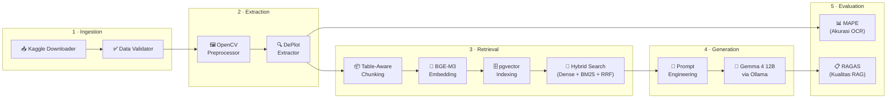

# 📊 Analisis Grafik Finansial RAG Pipeline

> Sistem cerdas berbasis **Retrieval-Augmented Generation (RAG)** yang mampu mengekstrak data dari gambar grafik finansial, menyimpannya ke vector database, dan menjawab pertanyaan analitis menggunakan LLM lokal.


---

## 📖 Deskripsi Project

Dalam dunia finansial, banyak data penting yang tersaji dalam bentuk **gambar grafik** seperti laporan tahunan, presentasi investor, atau dokumen PDF. Mengekstrak data dari gambar-gambar ini secara manual sangat memakan waktu dan rentan kesalahan.

Project ini menyediakan **pipeline end-to-end** yang secara otomatis:

1. **Membaca** gambar grafik finansial menggunakan Computer Vision dan model DePlot
2. **Mengekstrak** data numerik dari grafik menjadi tabel terstruktur
3. **Menyimpan** data tersebut ke vector database untuk pencarian semantik
4. **Menjawab** pertanyaan analitis tentang data menggunakan LLM lokal (tanpa kirim data ke cloud)
5. **Mengevaluasi** kualitas ekstraksi dan jawaban secara otomatis

---

## ✨ Fitur Utama

| Fitur | Deskripsi |
|---|---|
| 🔍 **Ekstraksi Grafik Otomatis** | Mengubah gambar grafik/chart menjadi tabel data terstruktur menggunakan Google DePlot |
| 🖼️ **Pra-Pemrosesan Cerdas** | Pembersihan gambar otomatis dengan OpenCV mendeteksi semua warna garis chart secara universal |
| 🧠 **Hybrid Search (RAG)** | Kombinasi Dense Vector Search + BM25 Sparse Search + Reciprocal Rank Fusion untuk pencarian konteks yang akurat |
| 💬 **Tanya-Jawab Berbasis Data** | LLM lokal (Gemma 4 12B) menjawab pertanyaan HANYA berdasarkan data yang diekstrak meminimalisir halusinasi |
| 📈 **Analisis Pola & Tren** | Deskripsi naratif otomatis tentang tren, puncak, dan insight dari grafik |
| ✅ **Evaluasi Ganda** | MAPE untuk akurasi OCR + RAGAS Framework untuk kualitas RAG (Faithfulness, Relevancy, Precision, Recall) |
| 🖥️ **Studio (UI)** | Satu ruang kerja di browser: unggah grafik, lihat progres, baca tabel & insight, lalu tanya jawab |
| 🔒 **100% Lokal & Privat** | Semua pemrosesan LLM berjalan di mesin lokal via Ollama data finansial tidak pernah keluar |

### Studio antarmuka web

Studio (`frontend/`) adalah aplikasi React yang memanggil API FastAPI. Alurnya tiga layar:

| Layar | Yang terlihat |
|---|---|
| **Atelier** | Unggah atau seret gambar PNG, JPG, atau WEBP (maks. 10 MB) |
| **Sedang bekerja** | Stepper: Bersihkan → Ekstrak → Insight → Siapkan tanya jawab, plus pratinjau berkas |
| **Workspace** | Grafik asli dan hasil pembersihan OpenCV, grafik garis yang digambar ulang dari tabel, tabel ekstraksi, kartu insight, dan panel tanya jawab |

Panel tanya jawab menampilkan saran pertanyaan, jawaban yang mengalir token demi token, dan potongan sumber dari hybrid search. Jika Ollama atau PostgreSQL tidak hidup, banner status di pojok kanan menjelaskan layanan mana yang belum terhubung. Analisis tabel tetap bisa selesai tanpa database; indexing yang gagal hanya menandai basis vektor belum siap.

Progres dikirim lewat Server-Sent Events (`/api/jobs/{id}/events`) dan dipolling cadangan tiap 2 detik. Pertanyaan dikirim ke `/api/ask` dan jawaban juga dialirkan lewat SSE.

---

## 🏗️ Arsitektur Sistem

### Diagram Pipeline



### Alur Data End-to-End

```
Gambar Grafik (.jpg/.png)
        │
        ▼
┌─────────────────────────┐
│ 1. INGESTION            │  Download dataset dari Kaggle
│    └─ Validasi format   │  Parsing & validasi tabel (cek numerik, persentase)
└─────────┬───────────────┘
          ▼
┌─────────────────────────┐
│ 2. EXTRACTION           │  Pra-pemrosesan gambar (OpenCV HSV filtering)
│    └─ DePlot OCR        │  Gambar grafik → Pandas DataFrame
└─────────┬───────────────┘
          ▼
┌─────────────────────────┐
│ 3. RETRIEVAL            │  Baris tabel → kalimat deskriptif (chunking)
│    └─ Indexing           │  Embedding (BGE-M3) → simpan ke PostgreSQL/pgvector
│    └─ Hybrid Search     │  Dense + BM25 + RRF → konteks terbaik
└─────────┬───────────────┘
          ▼
┌─────────────────────────┐
│ 4. GENERATION           │  Strict prompt + konteks → Gemma 4 12B (Ollama)
│    └─ Jawaban analitis  │  "Berdasarkan data X, nilainya adalah Y..."
└─────────┬───────────────┘
          ▼
┌─────────────────────────┐
│ 5. EVALUATION           │  MAPE: akurasi ekstraksi DePlot
│    └─ RAGAS metrics     │  Faithfulness, Relevancy, Precision, Recall
└─────────────────────────┘
```

---

## 🛠️ Tech Stack

| Kategori | Teknologi | Fungsi |
|---|---|---|
| **Vision / OCR** | [Google DePlot](https://huggingface.co/google/deplot) (Pix2Struct) | Mengekstrak data tabel dari gambar grafik |
| **Image Processing** | [OpenCV](https://opencv.org/) | Pra-pemrosesan gambar (deteksi warna, isolasi chart) |
| **Embedding** | [BAAI/bge-m3](https://huggingface.co/BAAI/bge-m3) (SentenceTransformer) | Mengubah teks menjadi vektor numerik untuk pencarian semantik |
| **Vector Database** | [PostgreSQL](https://www.postgresql.org/) + [pgvector](https://github.com/pgvector/pgvector) | Menyimpan dan mencari vektor embedding |
| **Sparse Search** | [rank-bm25](https://github.com/dorianbrown/rank_bm25) | Pencarian berbasis kecocokan kata kunci (BM25Okapi) |
| **LLM** | [Gemma 4 12B](https://ai.google.dev/gemma) via [Ollama](https://ollama.ai/) | Model bahasa lokal untuk generasi jawaban |
| **RAG Framework** | [LangChain](https://www.langchain.com/) | Orkestrasi komponen RAG |
| **Evaluation** | [RAGAS](https://docs.ragas.io/) | Evaluasi kualitas pipeline RAG |
| **Data Science** | Pandas, NumPy, Matplotlib, scikit-learn | Manipulasi data, perhitungan metrik, visualisasi |
| **Notebook** | Jupyter Notebook | Eksplorasi dan eksperimen data interaktif |
| **API** | [FastAPI](https://fastapi.tiangolo.com/) + Uvicorn | Job analisis, kesehatan layanan, dan streaming jawaban |
| **Frontend** | React 18, Vite, TypeScript, Tailwind CSS, Framer Motion | Studio: unggah, stepper, workspace |
| **Chart UI** | [Recharts](https://recharts.org/) | Menggambar ulang deret numerik dari tabel ekstraksi |
| **Dataset** | [Kaggle](https://www.kaggle.com/datasets/varadsrivastava/financial-chart-ocr) | Sumber dataset grafik finansial |

---

## 📁 Struktur Direktori

```
analisis-grafik/
│
├── 📄 .env.example              # Template konfigurasi environment variables
├── 📄 .gitignore                 # File/folder yang diabaikan Git
├── 📄 requirements.txt           # Daftar semua dependensi Python
├── 📄 README.md                  # Dokumentasi project (file ini)
│
├── 📂 data/                      # Diabaikan Git: unggahan, dataset, gambar uji
│   ├── 📂 uploads/               # Gambar asli + hasil pembersihan per job Studio
│   └── 📂 raw/                   # Dataset mentah dari Kaggle (opsional)
│
├── 📂 frontend/                  # Studio UI React
│   ├── index.html
│   ├── package.json
│   ├── vite.config.ts            # Dev server :5173, proxy /api → :8000
│   ├── tailwind.config.js
│   ├── 📂 public/
│   │   └── sample-chart.png
│   └── 📂 src/
│       ├── main.tsx
│       ├── App.tsx               # Atelier → proses → workspace
│       ├── index.css
│       ├── 📂 components/
│       │   ├── Dropzone.tsx      # Unggah / seret gambar
│       │   ├── Stepper.tsx       # Progres pembersihan sampai indexing
│       │   ├── StatusBanner.tsx  # Peringatan Ollama / PostgreSQL
│       │   ├── Workspace.tsx     # Hasil: gambar, chart, tabel, insight, chat
│       │   ├── ReconstructedChart.tsx
│       │   ├── DataTable.tsx
│       │   ├── InsightCard.tsx
│       │   └── ChatPanel.tsx     # Tanya jawab streaming + sumber
│       └── 📂 lib/
│           ├── api.ts            # Klien HTTP dan SSE
│           └── types.ts
│
├── 📂 notebooks/                 # Jupyter Notebooks untuk eksperimen
│   ├── data_exploration.ipynb
│   ├── data_validation.ipynb
│   └── vision_extraction_test.ipynb
│
└── 📂 src/                       # Pipeline Python + API
    ├── 📂 api/                   # Module Studio API
    │   ├── main.py               # FastAPI: health, jobs, ask
    │   ├── jobs.py               # Antrian job dan orkestrasi pipeline
    │   └── schemas.py
    │
    ├── 📂 ingestion/
    │   ├── downloader.py         # Download dataset dari Kaggle API
    │   └── validator.py          # Parsing & validasi tabel finansial
    │
    ├── 📂 extraction/
    │   └── extractor.py          # OpenCV + DePlot dalam satu modul
    │
    ├── 📂 retrieval/
    │   ├── indexer.py            # Chunking, embedding, insert ke pgvector
    │   └── search.py             # Hybrid search (Dense + BM25 + RRF)
    │
    ├── 📂 generation/
    │   ├── llm_client.py         # Prompt ketat, jawaban, dan streaming
    │   ├── prompts.py            # Template analisis grafik
    │   └── analyze_vision.py     # Panggilan Gemma untuk insight naratif
    │
    └── 📂 evaluation/
        ├── evaluate_extraction.py
        └── ragas_eval.py
```

---

## 📋 Prasyarat (Prerequisites)

Pastikan software berikut sudah terinstall di sistem Anda:

| Software | Versi Minimum | Keterangan |
|---|---|---|
| **Python** | 3.10+ | Runtime utama |
| **PostgreSQL** | 14+ | Database untuk pgvector |
| **pgvector** | 0.5+ | Ekstensi vektor untuk PostgreSQL |
| **Ollama** | Latest | Runtime LLM lokal |
| **Git** | 2.0+ | Version control |
| **Kaggle CLI** | Latest | Untuk download dataset (opsional) |
| **Node.js** | 18+ | Runtime frontend Studio (npm 9+) |

### Kebutuhan Hardware

| Komponen | Minimum | Rekomendasi |
|---|---|---|
| **RAM** | 16 GB | 32 GB |
| **VRAM (GPU)** | 8 GB | 12+ GB |
| **Storage** | 20 GB free | 50 GB free |

> **Catatan:** Model Gemma 4 12B membutuhkan setidaknya ~8 GB VRAM. Jika GPU tidak tersedia, Ollama akan menggunakan CPU (lebih lambat).

---

## 🚀 Instalasi & Setup

### 1. Clone Repository

```bash
git clone <repository-url>
cd analisis-grafik
```

### 2. Buat Virtual Environment

```bash
python -m venv venv

# Windows
venv\Scripts\activate

# Linux / macOS
source venv/bin/activate
```

### 3. Install Dependensi

```bash
pip install -r requirements.txt
```

### 4. Konfigurasi Environment Variables

Salin file template dan isi dengan kredensial Anda:

```bash
cp .env.example .env
```

Edit file `.env` dengan konfigurasi berikut:

```env
# Kaggle API (untuk download dataset)
KAGGLE_USERNAME=username_kaggle_anda
KAGGLE_KEY=api_key_kaggle_anda

# PostgreSQL Database
DB_HOST=localhost
DB_PORT=5433
DB_NAME=financial_rag
DB_USER=postgres
DB_PASS=postgres
```

### 5. Setup PostgreSQL + pgvector

```bash
# Buat database
createdb financial_rag

# Install ekstensi pgvector (di dalam psql)
psql -d financial_rag -c "CREATE EXTENSION IF NOT EXISTS vector;"
```

**Atau menggunakan Docker (rekomendasi):**

```bash
docker run -d \
  --name pgvector-db \
  -e POSTGRES_PASSWORD=postgres \
  -e POSTGRES_DB=financial_rag \
  -p 5433:5432 \
  pgvector/pgvector:pg16
```

### 6. Install & Jalankan Ollama

```bash
# Install Ollama (https://ollama.ai)
# Lalu download model Gemma 4 12B:
ollama pull gemma4:12b
```

Pastikan Ollama berjalan di background:

```bash
ollama serve
```

### 7. Studio Frontend (UI)

Studio adalah cara utama memakai pipeline: unggah grafik, ikuti progres, lalu baca hasil di workspace.

**Backend API** (dari root project, virtualenv aktif):

```bash
pip install -r requirements.txt
python -m uvicorn src.api.main:app --reload --port 8000
```

Dokumentasi interaktif API: [http://127.0.0.1:8000/docs](http://127.0.0.1:8000/docs).

**Frontend** (terminal kedua):

```bash
cd frontend
npm install
npm run dev
```

Buka [http://localhost:5173](http://localhost:5173). Jika port itu sudah terpakai, Vite memilih port berikutnya (misalnya 5174) dan mencetaknya di terminal. Vite mem-proxy `/api` ke `http://127.0.0.1:8000`.

Ollama (`gemma4:12b`) menyusun insight dan jawaban. PostgreSQL + pgvector menyimpan potongan tabel agar tanya jawab bisa mencari konteks. Jika database mati, tabel dan insight tetap muncul; panel tanya jawab menandai basis vektor belum terhubung.

**Endpoint yang dipakai Studio**

| Method | Path | Fungsi |
|---|---|---|
| `GET` | `/api/health` | Status Ollama, PostgreSQL, dan nama model |
| `POST` | `/api/jobs` | Unggah gambar, mulai pipeline di thread latar |
| `GET` | `/api/jobs/{id}` | Snapshot status, pesan, dan jejak langkah |
| `GET` | `/api/jobs/{id}/events` | SSE progres sampai `ready` atau `failed` |
| `GET` | `/api/jobs/{id}/result` | Tabel, insight, dan status indexing |
| `GET` | `/api/jobs/{id}/image/{kind}` | Gambar `original` atau `cleaned` |
| `POST` | `/api/ask` | SSE jawaban RAG (delta token + sumber) |

**Langkah di dalam satu job**

1. **Bersihkan** OpenCV mengisolasi warna garis dan teks, menyimpan kanvas bersih.
2. **Ekstrak** DePlot mengubah gambar bersih menjadi tabel pandas.
3. **Insight** prompt analisis dikirim ke Gemma lewat Ollama.
4. **Siapkan tanya jawab** baris tabel di-chunk, di-embed (BGE-M3), lalu disimpan ke `financial_docs`.

Berkas unggahan tersimpan di `data/uploads/` (`{id}_original.*` dan `{id}_cleaned.png`). Folder `data/` tidak masuk Git.

### 8. Download Dataset (Opsional)

```bash
python src/ingestion/downloader.py
```

> Dataset akan otomatis diunduh dan diekstrak ke folder `data/raw/`.

---

## 💻 Cara Penggunaan

### Pipeline Lengkap (Step by Step)

#### Tahap 1 & 2 Bersihkan lalu ekstrak (OpenCV + DePlot)

Pra-pemrosesan dan pembacaan tabel ada di satu modul:

```bash
python src/extraction/extractor.py
```

Skrip ini memanggil `process_chart_pipeline` pada berkas contoh di `data/`. Log yang dicetak:

```
[1/3] OpenCV sedang membersihkan gambar: ...
[2/3] DePlot mengekstrak tabel dari gambar bersih...
[3/3] Sukses! Data berhasil diekstrak:
=== HASIL AKHIR PIPELINE ===
```

Di Studio, langkah yang sama dijalankan per unggahan di `src/api/jobs.py`, lalu hasilnya ditampilkan sebagai tabel dan grafik garis.

#### Tahap 3 Indexing ke Vector Database

Simpan data yang sudah diekstrak ke PostgreSQL/pgvector:

```bash
python src/retrieval/indexer.py
```

Proses yang terjadi:
1. Table-aware chunking (baris → kalimat deskriptif)
2. Embedding dengan model BGE-M3
3. Bulk insert ke tabel `financial_docs`

#### Tahap 4 Tanya-Jawab RAG (Hybrid Search + LLM)

Ajukan pertanyaan dan dapatkan jawaban berbasis data:

```bash
python src/generation/llm_client.py
```

Contoh interaksi:
```
User: Berapa persen laba bersih pada tahun 2023 berdasarkan simulasi laporan?

[Proses] Menjalankan pencarian konteks (Vector + BM25)...
[Proses] Menghubungi model gemma4:12b via API lokal...

=== JAWABAN LLM ===
Berdasarkan Tren Pendapatan Tahunan (Sumber: Laporan_Q3_Simulasi.png),
laba bersih pada tahun 2023 adalah 18.2%.
===================
```

#### Tahap 5 Analisis Pola Grafik (Vision → Narasi)

Dapatkan deskripsi naratif tentang tren dan pola dari grafik:

```bash
python src/generation/analyze_vision.py
```

Output: deskripsi profesional tentang tren naik/turun, titik puncak, dan insight bisnis.

### Menggunakan Jupyter Notebooks

Untuk eksplorasi interaktif dan eksperimen:

```bash
jupyter notebook notebooks/
```

| Notebook | Kegunaan |
|---|---|
| `data_exploration.ipynb` | Eksplorasi dataset Kaggle, visualisasi distribusi data |
| `data_validation.ipynb` | Validasi kualitas dan konsistensi data |
| `vision_extraction_test.ipynb` | Pengujian dan perbandingan hasil ekstraksi DePlot |

---

## 📊 Evaluasi Model

Project ini menggunakan **dua mekanisme evaluasi** untuk memastikan kualitas output:

### 1. Evaluasi Akurasi Ekstraksi (MAPE)

Mengukur seberapa akurat DePlot membaca angka dari gambar grafik dibandingkan dengan ground truth yang diketik manual.

```bash
python src/evaluation/evaluate_extraction.py
```

**Metrik: Mean Absolute Percentage Error (MAPE)**

| Rumus | Interpretasi |
|---|---|
| `MAPE = mean(\|actual - predicted\| / actual) × 100%` | Semakin rendah = semakin akurat |

**Threshold:** MAPE ≤ 5% → ✅ LULUS | MAPE > 5% → ❌ GAGAL

Contoh output:
```
=== EVALUASI AKURASI EKSTRAKSI DEPLOT ===
- Otomotif: 5.24% Error
- Jasa Keuangan: 17.00% Error
- Alat Berat & Pertambangan: 36.27% Error
- Segmen Lainnya: 25.89% Error
----------------------------------------
RATA-RATA ERROR KESELURUHAN: 21.10%

[Status Evaluasi - Threshold 5%]
❌ Ekstraksi GAGAL. Tingkat halusinasi visual / kesalahan baca terlalu tinggi.
Saran: Gunakan gambar dengan label data eksplisit atau tingkatkan kualitas pra-pemrosesan gambar.
```

### 2. Evaluasi Kualitas RAG (RAGAS Framework)

Mengukur kualitas pipeline RAG secara keseluruhan menggunakan LLM sebagai juri otomatis.

```bash
python src/evaluation/ragas_eval.py
```

**Metrik yang dievaluasi:**

| Metrik | Mengukur | Skor Ideal |
|---|---|---|
| **Faithfulness** | Apakah jawaban bebas halusinasi? (sesuai konteks) | 1.0 |
| **Answer Relevancy** | Apakah jawaban relevan dengan pertanyaan? | 1.0 |
| **Context Precision** | Apakah konteks yang diambil tepat sasaran? | 1.0 |
| **Context Recall** | Apakah semua informasi yang dibutuhkan berhasil ditemukan? | 1.0 |

> **Catatan:** Evaluasi RAGAS menggunakan model LLM yang sama (Gemma 4 12B) sebagai "judge". Proses ini membutuhkan waktu beberapa menit.

---

## 📦 Dataset

### Sumber

Dataset yang digunakan berasal dari Kaggle:

**[Financial Chart OCR](https://www.kaggle.com/datasets/varadsrivastava/financial-chart-ocr)** oleh Varad Srivastava

### Struktur Dataset

```
data/raw/
├── natural_data/           # Grafik dari sumber nyata
│   ├── annotations/        # Ground truth (data tabel yang benar)
│   ├── images/             # Gambar grafik asli
│   └── index.json          # Metadata dan indeks dataset
│
└── synthetic_data/         # Grafik yang digenerate secara sintetis
    ├── charts/             # Gambar chart sintetis
    └── markdown/           # Data tabel dalam format markdown
```

### Cara Download

**Opsi 1 Via script otomatis:**
```bash
# Pastikan KAGGLE_USERNAME dan KAGGLE_KEY sudah diisi di .env
python src/ingestion/downloader.py
```

**Opsi 2 Via Kaggle CLI:**
```bash
kaggle datasets download -d varadsrivastava/financial-chart-ocr -p data/raw --unzip
```

**Opsi 3 Manual:**
Download langsung dari [halaman Kaggle](https://www.kaggle.com/datasets/varadsrivastava/financial-chart-ocr), lalu ekstrak ke folder `data/raw/`.

---

## 🔑 Konfigurasi Environment

Buat file `.env` di root project berdasarkan template `.env.example`:

```env
# ============================================
# Kaggle API Credentials
# Dapatkan dari: https://www.kaggle.com/settings → API → Create New Token
# ============================================
KAGGLE_USERNAME=your_kaggle_username
KAGGLE_KEY=your_kaggle_api_key

# ============================================
# PostgreSQL + pgvector Configuration
# ============================================
DB_HOST=localhost
DB_PORT=5432
DB_NAME=financial_rag
DB_USER=postgres
DB_PASS=postgres
```

---

## 📄 Lisensi

Project ini dibuat untuk tujuan edukasi dan riset.

---

## 📚 Referensi

### Model & Framework

| Referensi | Link |
|---|---|
| **Google DePlot** | [HuggingFace google/deplot](https://huggingface.co/google/deplot) |
| **BGE-M3 Embedding** | [HuggingFace BAAI/bge-m3](https://huggingface.co/BAAI/bge-m3) |
| **Gemma 4** | [Google AI Gemma](https://ai.google.dev/gemma) |
| **Ollama** | [ollama.ai](https://ollama.ai/) |
| **pgvector** | [GitHub pgvector](https://github.com/pgvector/pgvector) |
| **RAGAS** | [docs.ragas.io](https://docs.ragas.io/) |
| **LangChain** | [langchain.com](https://www.langchain.com/) |

### Dataset

| Dataset | Link |
|---|---|
| **Financial Chart OCR** | [Kaggle varadsrivastava/financial-chart-ocr](https://www.kaggle.com/datasets/varadsrivastava/financial-chart-ocr) |

### Paper

- Liu, F., et al. (2023). *DePlot: One-shot visual language reasoning by plot-to-table translation.* [arXiv](https://arxiv.org/abs/2212.10505)
- Chen, J., et al. (2024). *BGE M3-Embedding: Multi-Lingual, Multi-Functionality, Multi-Granularity Text Embeddings Through Self-Knowledge Distillation.* [arXiv](https://arxiv.org/abs/2402.03216)
- Es, S., et al. (2023). *RAGAS: Automated Evaluation of Retrieval Augmented Generation.* [arXiv](https://arxiv.org/abs/2309.15217)
